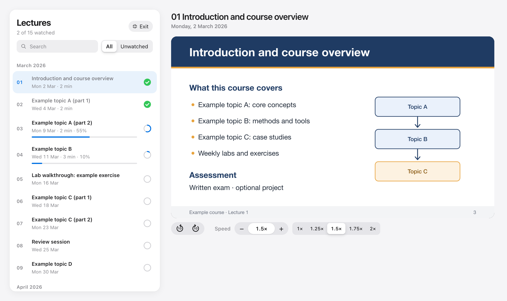
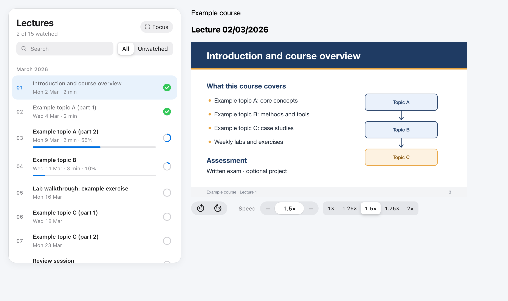

# Lecture Library for PoliTo

A Chrome extension that makes the **video lectures** on the Politecnico di Torino teaching portal easier to study with: an ordered lecture library, progress tracking, automatic resume, a distraction-free focus mode, any playback speed and 10-second skip.

> **Unofficial project.** It is not affiliated with, endorsed by or supported by Politecnico di Torino. It only changes how the lecture page looks in your own browser.

## Features

**Lecture library**
- Lectures numbered and grouped by month, with clean titles (no repeated dates)
- Search and an *Unwatched* filter
- Progress bar for each lecture, a ring that fills as you watch, and a green tick once a lecture is finished (you can also mark lectures as watched or unwatched by hand)
- Automatic resume: a lecture restarts where you left it
- A *New* badge on recently uploaded lectures

**Focus mode**
- One click (or <kbd>F</kbd>) hides everything except the lecture list and a large player
- <kbd>Esc</kbd> or <kbd>F</kbd> brings the normal page back; the choice is remembered

**Player controls**
- Any playback speed from 0.25× to 4×, in steps of 0.10, plus presets (1×, 1.25×, 1.5×, 1.75×, 2×)
- Type an exact speed (both `1.35` and `1,35` work)
- Skip back or forward by 10 seconds
- The chosen speed is remembered between lectures

## Keyboard shortcuts

Shortcuts work on the Virtual classroom page whenever you are not typing in a text field. They are chosen to work on Italian and US keyboards.

| Key | Action |
|---|---|
| <kbd>+</kbd> | Faster (+0.10) |
| <kbd>−</kbd> | Slower (−0.10) |
| <kbd>0</kbd> | Normal speed |
| <kbd>←</kbd> / <kbd>→</kbd> | Back / forward 10 seconds |
| <kbd>F</kbd> | Toggle focus mode |
| <kbd>Esc</kbd> | Leave focus mode |

Inside the speed field, <kbd>↑</kbd> / <kbd>↓</kbd> change the speed and <kbd>Return</kbd> applies a typed value.

## Installation

The extension is not on the Chrome Web Store yet. To install it from this repository:

1. Download the repository (**Code → Download ZIP**) and unzip it, or clone it with `git clone`.
2. Open `chrome://extensions` in Chrome.
3. Turn on **Developer mode** (top right).
4. Click **Load unpacked** and select the folder that contains `manifest.json`.
5. Open a course page on the teaching portal and go to **Virtual classroom**.

To update, replace the folder with the new version and click the reload arrow on the extension in `chrome://extensions`.

It also works in other Chromium-based browsers (Edge, Brave, Arc).

## Privacy

- **No data leaves your browser.** The extension makes no network requests and has no analytics.
- It stores only your preferences and lecture progress, in Chrome's local extension storage.
- It is loaded only on course pages of the teaching portal and acts only on the **Virtual classroom** (the recordings list and the lecture player). Every other page, and every other video, is left untouched.
- It only needs the `storage` permission.
- It does not read or store credentials, and it does not download or redistribute any lecture content.

See [PRIVACY.md](PRIVACY.md) for details.

## How it works

The extension runs only on a course's Virtual classroom page. The portal's page is left in place: the extension hides the original list and buttons and draws its own interface on top (in a shadow DOM, so styles do not clash). Opening a lecture from the library still uses the portal's own loader, so lectures load exactly as before.

If the portal changes its page structure, the library may stop appearing; the original page then simply shows as usual. Please open an issue if that happens.

| File | Purpose |
|---|---|
| `manifest.json` | Extension manifest (Manifest V3) |
| `content.js` | Speed and skip controls for the lecture player, keyboard shortcuts, on-video indicator, hiding of the player's fixed speed buttons |
| `library.js` | Lecture library, progress, resume, focus mode |
| `popup.html`, `popup.js` | Toolbar popup (speed slider and presets) |
| `icons/` | Extension icons (`icon.svg` is the source) |

## Contributing

Issues and pull requests are welcome. Please keep the extension free of network requests and tracking, and test changes on a real lecture page.

## Italiano

Estensione per Chrome **non ufficiale** che rende più comode le videolezioni del Portale della Didattica del Politecnico di Torino:
- libreria ordinata delle lezioni, con avanzamento, ripresa automatica e spunte "vista";
- modalità Focus con solo elenco e player;
- qualsiasi velocità di riproduzione, preset e salto di 10 secondi.

**Installazione:**
1. Scarica la cartella.
2. Apri `chrome://extensions` e attiva la **Modalità sviluppatore**.
3. Clicca **Carica estensione non pacchettizzata** e scegli la cartella che contiene `manifest.json`.

Nessun dato esce dal browser.

## License

[MIT](LICENSE)
